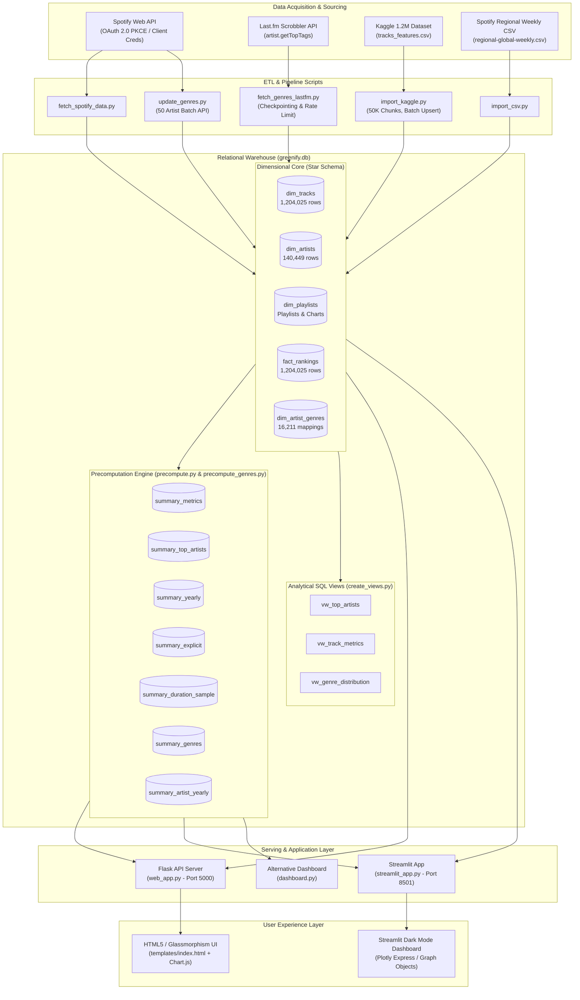
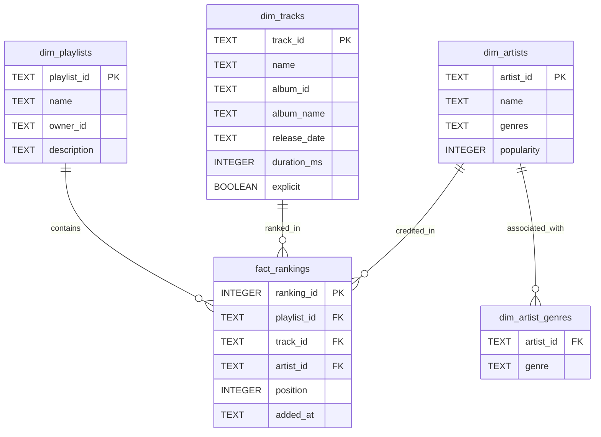

# Greenify (Greentify) — System Architecture Document

## 1. Executive Summary & Overview

**Greenify** (branded in user interfaces as **Greentify**) is an end-to-end music analytics and data engineering platform built around Spotify and music streaming ecosystems. The platform ingests, normalizes, enriches, and visualizes massive audio datasets—scaling up to **1,204,025 tracks**, **140,449 artists**, and **1,700+ genres**.

The core objective of the system is to solve the analytical performance bottleneck inherent in large-scale relational datasets: enabling sub-second, interactive querying, filtering, and visual reporting over 1.2+ million records on lightweight, embedded infrastructure without needing heavyweight distributed compute clusters.

```
+-----------------------------------------------------------------------------------------+
|                                    GREENIFY PLATFORM                                    |
+-----------------------------------------------------------------------------------------+
|                                                                                         |
|   +--------------------+   +---------------------+   +-----------------------------+    |
|   |  Spotify Web API   |   | Last.fm Tagging API |   | Kaggle & CSV Dataset Ingest |    |
|   +---------+----------+   +----------+----------+   +--------------+--------------+    |
|             |                         |                             |                   |
|             +-------------------------+-----------------------------+                   |
|                                       | (ETL Pipelines)                                 |
|                                       v                                                 |
|   +---------------------------------------------------------------------------------+   |
|   |                                SQLite Star Schema                               |   |
|   |         dim_tracks | dim_artists | dim_playlists | fact_rankings | dim_genres   |   |
|   +-----------------------------------+---------------------------------------------+   |
|                                       | (Batch Precompute Engine)                       |
|                                       v                                                 |
|   +---------------------------------------------------------------------------------+   |
|   |                   Precomputed Materialized Summary Layer (OLAP)                 |   |
|   |   summary_metrics | summary_top_artists | summary_yearly | summary_artist_yearly|   |
|   +-----------------------------------+---------------------------------------------+   |
|                                       |                                                 |
|                     +-----------------+-----------------+                               |
|                     |                                   |                               |
|                     v                                   v                               |
|       +---------------------------+       +---------------------------+                 |
|       |   Flask REST Service      |       |   Streamlit Dashboards    |                 |
|       |   (web_app.py :5000)      |       |   (streamlit_app.py :8501)|                 |
|       +-------------+-------------+       +---------------------------+                 |
|                     |                                                                   |
|                     v                                                                   |
|       +---------------------------+                                                     |
|       | Modern HTML5/CSS3 SPA     |                                                     |
|       | (Glassmorphism & Chart.js)|                                                     |
|       +---------------------------+                                                     |
+-----------------------------------------------------------------------------------------+
```

---

## 2. High-Level System Architecture

The system is structured across four primary architectural tiers:

1. **Ingestion & Enrichment Tier (ETL Engine)**: Connectors and batch loaders extracting music metadata, audio properties, chart positions, and tags from multiple external and local providers.
2. **Persistence & OLAP Acceleration Tier (Storage Engine)**: An embedded relational database configured as a star schema, coupled with precomputed summary tables and dynamic analytical SQL views.
3. **Application & Serving Tier (API Engine)**: A lightweight Python microservice serving REST APIs with parameterized SQL query optimization and HTTP cache control headers.
4. **Presentation & Visualization Tier (Frontend)**: Dual interactive interfaces—a custom Glassmorphic HTML5/CSS3 Single-Page Application (SPA) with Chart.js and wave canvas animations, alongside Python-native Streamlit and Plotly analytical dashboards.



---

## 3. Data Sources & ETL Architecture

### 3.1. External & File Data Sources

| Source | Protocol / Mechanism | Input Attributes | Purpose |
| :--- | :--- | :--- | :--- |
| **Spotify Web API** | OAuth 2.0 Auth Code / Client Credentials via `spotipy` | Track metadata, album, release date, explicit flag, duration, artist profile, popularity | Real-time playlist and chart sync (`Top 50 - Global`, `Top 50 - Turkey`, user playlists). |
| **Kaggle 1.2M Songs** | Local CSV via `kagglehub` (`tracks_features.csv`) | `id`, `name`, `album`, `album_id`, `artists`, `artist_ids`, `release_date`, `duration_ms`, `explicit`, `year` | Massive historical baseline dataset spanning 1920–2024. |
| **Spotify Charts CSV** | Static CSV export (`regional-global-weekly-2026-09-24.csv`) | `rank`, `uri`, `track_name`, `artist_names`, `streams`, `source` | Weekly chart snapshot ingestion. |
| **Last.fm Web API** | REST API (`artist.getTopTags`, JSON) | Top tags/genres with user frequency weights | Secondary genre attribution when Spotify genre data is sparse. |

### 3.2. ETL Ingestion Modules

#### 1. `import_kaggle.py`
- **Memory-Safe Chunking**: Iterates over `tracks_features.csv` in chunks of `50,000` rows using `pandas.read_csv(chunksize=50000)`.
- **AST Parsing**: Evaluates serialized Python list strings (`"['id1', 'id2']"`) into native lists to resolve multi-artist collaborations.
- **Bulk Loading**: Executes `cursor.executemany()` for `dim_artists`, `dim_tracks`, and `fact_rankings` inside SQLite transactions, maintaining optimal I/O throughput.

#### 2. `fetch_spotify_data.py`
- **Authentication**: Initiates Spotipy's `SpotifyOAuth` against `http://127.0.0.1:9090` using cached credentials in `.spotify_cache`.
- **Playlist & Track Extraction**: Reads playlists defined in `PLAYLISTS` dictionary, paginating through track collections.
- **UPSERT Strategy**: Employs SQLite `INSERT ... ON CONFLICT(...) DO UPDATE` to keep existing records current without duplicate key violations.

#### 3. `fetch_genres_lastfm.py`
- **Rate-Limiting Control**: Limits calls to `4.5 req/sec` (`RATE_LIMIT = 0.22s`) to conform with Last.fm's 5 req/sec threshold.
- **Persistent Checkpointing**: Maintains state in `lastfm_checkpoint.json` (`processed`, `updated`, `not_found`). If interrupted via `SIGINT`/Ctrl+C, progress is safely flushed and resumes seamlessly.
- **Batch Commits**: Batches database updates in blocks of 200 to prevent transaction overhead.

#### 4. `update_genres.py`
- **API Batching**: Groups unpopulated artist IDs into batches of 50 (`sp.artists(batch)`), taking advantage of Spotify's maximum batch size.

#### 5. `import_csv.py`
- **Chart Parsing**: Extracts `track_id` from Spotify URIs (`spotify:track:XXXXX -> XXXXX`), creates deterministic synthetic IDs for artists (`csv_artist_name`), and records rankings.

---

## 4. Database Architecture & Data Modeling

The relational backend is implemented in **SQLite 3** (`greenify.db`, ~457 MB). SQLite was chosen for portability, zero-configuration local hosting, and near-zero read latency when properly indexed and cached.

### 4.1. Storage Engine Engine Optimizations
- **Write-Ahead Logging (WAL)**: Enabled via `PRAGMA journal_mode=WAL` to permit concurrent readers alongside writer operations.
- **Memory Caching**: Configured via `PRAGMA cache_size=-64000` (64 MB memory cache) to keep working indexes in RAM.
- **Synchronous Mode**: Configured to `PRAGMA synchronous=NORMAL` for balanced durability and batch write performance.

---

### 4.2. Star Schema Entity-Relationship (ER) Diagram



---

### 4.3. Relational Table Specifications

#### Dimension: `dim_tracks` (1,204,025 records)
| Column | Type | Constraints | Description |
| :--- | :--- | :--- | :--- |
| `track_id` | TEXT | PRIMARY KEY | Spotify Base62 Track Identifier or source key |
| `name` | TEXT | NOT NULL | Title of the track |
| `album_id` | TEXT | NULLABLE | Identifier of the parent album |
| `album_name` | TEXT | NULLABLE | Display name of the parent album |
| `release_date` | TEXT | NULLABLE | ISO-8601 formatted release date (`YYYY-MM-DD` or `YYYY`) |
| `duration_ms` | INTEGER | DEFAULT 0 | Track length in milliseconds |
| `explicit` | BOOLEAN | DEFAULT 0 | 1 if track contains explicit content, 0 otherwise |

#### Dimension: `dim_artists` (140,449 records)
| Column | Type | Constraints | Description |
| :--- | :--- | :--- | :--- |
| `artist_id` | TEXT | PRIMARY KEY | Spotify Artist Identifier or synthetic CSV key |
| `name` | TEXT | NOT NULL | Artist display name |
| `genres` | TEXT | NULLABLE | Comma-delimited genre string (e.g., `'pop, dance pop'`) |
| `popularity` | INTEGER | DEFAULT 0 | Spotify popularity index (0–100) |

#### Dimension: `dim_playlists` (1+ records)
| Column | Type | Constraints | Description |
| :--- | :--- | :--- | :--- |
| `playlist_id` | TEXT | PRIMARY KEY | Spotify playlist ID or synthetic collection ID |
| `name` | TEXT | NOT NULL | Playlist display title |
| `owner_id` | TEXT | NULLABLE | Creator/Curator identifier |
| `description` | TEXT | NULLABLE | Textual description |

#### Fact Table: `fact_rankings` (1,204,025 records)
| Column | Type | Constraints | Description |
| :--- | :--- | :--- | :--- |
| `ranking_id` | INTEGER | PRIMARY KEY AUTOINCREMENT | Surrogate fact key |
| `playlist_id` | TEXT | FK -> `dim_playlists(playlist_id)` | Foreign key to playlist context |
| `track_id` | TEXT | FK -> `dim_tracks(track_id)` | Foreign key to track dimension |
| `artist_id` | TEXT | FK -> `dim_artists(artist_id)` | Foreign key to primary artist dimension |
| `position` | INTEGER | NULLABLE | Chart ranking or sequence position within playlist |
| `added_at` | TEXT | NULLABLE | Timestamp or snapshot date string |

#### Normalization Dimension: `dim_artist_genres` (16,211 records)
| Column | Type | Constraints | Description |
| :--- | :--- | :--- | :--- |
| `artist_id` | TEXT | INDEXED | Foreign key to `dim_artists(artist_id)` |
| `genre` | TEXT | INDEXED | Individual normalized genre token (lowercased) |

---

### 4.4. Materialized OLAP Acceleration Layer (Summary Tables)

Performing `COUNT(DISTINCT)` or multi-table joins across 1.2M rows introduces a 1.5–4.0 second query penalty in SQLite. Greenify overcomes this with precomputed summary tables generated via `precompute.py` and `precompute_genres.py`:

| Table Name | Cardinality | Primary Columns | Target Analytical Query | Speedup Factor |
| :--- | :--- | :--- | :--- | :--- |
| `summary_metrics` | 1 row | `total_tracks`, `total_artists`, `total_playlists`, `avg_duration_min`, `explicit_count` | Dashboard header KPI cards | **> 1,000x** (instant) |
| `summary_top_artists` | 85,113 rows | `artist_id`, `artist`, `track_count` | All-time top artist leaderboard | **~80x** |
| `summary_yearly` | 100 rows | `year`, `track_count` | 1920–2024 catalog release timeline | **~120x** |
| `summary_explicit` | 2 rows | `type` (`'Explicit'`, `'Clean'`), `count` | Content breakdown donut chart | **~250x** |
| `summary_duration_sample`| 20,000 rows | `duration_min` | Duration distribution histogram | **~150x** |
| `summary_genres` | 1,715 rows | `genre`, `artist_count`, `track_count` | Genre distribution charts | **~300x** |
| `summary_artist_yearly` | 145,631 rows | `artist_id`, `year`, `track_count` | Filtered top artist rankings by year range | **~50x** |

---

### 4.5. Analytical SQL Views (`create_views.py`)

1. **`vw_top_artists`**:
   - Joins `dim_artists`, `fact_rankings`, and `dim_playlists`.
   - Aggregates distinct tracks and playlists per artist with `GROUP_CONCAT(DISTINCT p.name)`.
2. **`vw_track_metrics`**:
   - Denormalizes `dim_tracks`, `dim_artists`, and `dim_playlists`.
   - Converts `duration_ms` into floating-point minutes (`ROUND(duration_ms / 60000.0, 2)`) and evaluates boolean flags to `'Yes'/'No'`.
3. **`vw_genre_distribution`**:
   - Employs a **Recursive Common Table Expression (CTE)** (`WITH RECURSIVE split(...)`) to dynamically parse comma-separated genre tokens into discrete rows on SQLite without external extensions.

---

### 4.6. Database Indexing Scheme

The indexing layout eliminates table scans across key join and query filter paths:

```sql
-- Fact table foreign key indexes
CREATE INDEX idx_rankings_track    ON fact_rankings(track_id);
CREATE INDEX idx_rankings_artist   ON fact_rankings(artist_id);
CREATE INDEX idx_rankings_playlist ON fact_rankings(playlist_id);

-- Dimension filter indexes
CREATE INDEX idx_tracks_release    ON dim_tracks(release_date);
CREATE INDEX idx_tracks_explicit   ON dim_tracks(explicit);

-- Summary & Precompute acceleration indexes
CREATE INDEX idx_top_artists_count ON summary_top_artists(track_count DESC);
CREATE INDEX idx_yearly_year       ON summary_yearly(year);
CREATE INDEX idx_say_year          ON summary_artist_yearly(year, track_count DESC);
CREATE INDEX idx_say_artist        ON summary_artist_yearly(artist_id);
CREATE INDEX idx_dag_artist        ON dim_artist_genres(artist_id);
CREATE INDEX idx_dag_genre         ON dim_artist_genres(genre);
CREATE INDEX idx_sg_tracks         ON summary_genres(track_count DESC);
```

---

## 5. Backend & API Service Architecture (`web_app.py`)

The backend is implemented as a lightweight **Flask** HTTP application exposing JSON endpoints consumed by the web client.

```
+---------------------------------------------------------------------------------------+
|                                    FLASK REST API                                     |
+---------------------------------------------------------------------------------------+
|  Route                 | Query Parameters        | Target Storage Table               |
+------------------------+-------------------------+------------------------------------+
| GET /                  | -                       | templates/index.html (HTML5 SPA)   |
| GET /api/metrics       | -                       | summary_metrics                    |
| GET /api/top-artists   | n, min_year, max_year   | summary_top_artists / yearly       |
| GET /api/yearly        | min, max                | summary_yearly                     |
| GET /api/explicit      | -                       | summary_explicit                   |
| GET /api/duration      | -                       | summary_duration_sample            |
| GET /api/search        | q, limit, min_y, max_y  | dim_tracks + fact_rankings (JOIN)  |
| GET /api/artists       | n, q, min_y, max_y      | summary_artist_yearly / top_artists|
| GET /api/genres/top    | n                       | summary_genres                     |
+---------------------------------------------------------------------------------------+
```

### 5.1. Endpoint Specifications

#### 1. `GET /api/metrics`
- **Output**:
  ```json
  {
    "total_tracks": 1204025,
    "total_artists": 140449,
    "total_playlists": 1,
    "avg_duration_min": 4.12,
    "explicit_count": 94820
  }
  ```
- **Execution Time**: `< 2ms`

#### 2. `GET /api/top-artists?n=15&min_year=1990&max_year=2024`
- **Logic**: Dual-route optimization:
  - If `min_year` and `max_year` encompass the all-time range (1960–2024), queries `summary_top_artists` directly (`O(1)` index scan).
  - If custom range is specified, performs a grouped aggregate over `summary_artist_yearly` filtered on `year BETWEEN ? AND ?`.
- **Output**: Array of `{ "artist": "...", "track_count": 1234 }`.

#### 3. `GET /api/search?q=bohemian&limit=50&min_year=1970&max_year=1980`
- **Logic**: Parameterized SQL filter executing `WHERE (t.name LIKE ? OR a.name LIKE ?) AND t.release_date BETWEEN ? AND ?`.
- **Output**: Array of objects containing track title, artist name, album, year, duration in minutes, explicit status, and genre string.

#### 4. `GET /api/genres/top?n=15`
- **Logic**: Reads directly from `summary_genres ORDER BY track_count DESC LIMIT ?`.
- **Output**: Array of `{ "genre": "rock", "artist_count": 1450, "track_count": 15820 }`.

---

## 6. Frontend & User Experience Architecture

Greenify offers two distinct frontend interfaces tailored to different usage modes:

### 6.1. Custom Web SPA (`templates/index.html` + `web_app.py`)

A Single-Page Application (SPA) adhering to modern web design standards:

1. **Design System & Aesthetics**:
   - **Spotify Dark / Light Theme**: Controlled via CSS Custom Properties (`--bg`, `--card-bg`, `--emerald`, `--t1`, `--b`). Supports toggle persistence via `data-theme`.
   - **Glassmorphism**: Backdrop blur filters (`backdrop-filter: blur(32px)`) with subtle green radial glows.
   - **Dynamic Audio Wave Canvas**: An HTML5 `<canvas id="wc">` rendering smooth procedural animated waves behind content.
2. **Component Hierarchy**:
   - `aside.sidebar`: Collapsible navigation with SVG iconography (`Overview`, `Tracks`, `Artists`).
   - `header.topbar`: Global debounced search bar with keyboard shortcut (`Cmd/Ctrl + K`) and connection status pills.
   - `section#pg-overview`: Hero cards and quick navigation jumping to deep analytics.
   - `section#pg-tracks`: Dual-handle release year slider, 4 metric cards, and mini-tab panels:
     - Search & Results Table (with explicit badges `[E]` / `[C]`).
     - Top Artists (Horizontal Chart.js Bar Chart).
     - Content Split (Chart.js Donut Chart).
     - Release Timeline (Chart.js Line/Area Chart).
     - Duration Distribution (Chart.js Histogram).
   - `section#pg-artists`: Top artist cards with catalog proportion progress bars and searchable grid.
3. **Visualization Engine**: **Chart.js 4.4** configured with responsive canvas wrappers, custom emerald palettes (`#1ED760`), and transparent gridlines.

```
+-----------------------------------------------------------------------------------+
|  GREENIFY WEB SPA (templates/index.html)                                          |
|                                                                                   |
|  [Sidebar]    [Topbar: Search (Cmd+K) | API Status | Theme Toggle (Moon/Sun)]     |
|  - Overview   ------------------------------------------------------------------  |
|  - Tracks     [Hero Banner: Greentify Platform Overview]                         |
|  - Artists    [Quick Nav: Tracks Analytics | Artists Directory]                   |
|               ------------------------------------------------------------------  |
|               [Metric Cards: Total Tracks | Total Artists | Avg Dur | Explicit]   |
|               ------------------------------------------------------------------  |
|               [Dual-Slider: 1960 <=================================> 2024]       |
|               [Tabs: 🔍 Search | 🏆 Top Artists | 🍩 Split | 📈 Timeline | ⏱ Dur]  |
|               [Dynamic Chart.js & Table Container Area]                           |
+-----------------------------------------------------------------------------------+
```

---

### 6.2. Streamlit Analytical Dashboards

#### 1. `streamlit_app.py` (Emerald Dark Theme)
- Native Streamlit deployment configured via `.streamlit/config.toml` (`#080c09` background, `#1ED760` primary).
- **Caching**: Decorated with `@st.cache_data(ttl=60)` to prevent redundant database hits on UI interactions.
- **Plotly Integration**: Generates custom `plotly.graph_objects` figures with styled hover templates, zero-margin paddings, and custom color gradients.
- **Navigation**: Multi-page selector switching between Overview, Tracks, and Artists.

#### 2. `dashboard.py` (Light Glassmorphic Variant)
- Light-mode dashboard with soft green gradient backgrounds (`#F4F8F5`), responsive metric cards with CSS transform hover animations (`translateY(-5px)`), and Plotly Express visualizations.

---

## 7. Security, Configuration & Environment Management

```
                 +-----------------------+
                 |       .env File       |
                 +-----------+-----------+
                             |
         +-------------------+-------------------+
         |                                       |
         v                                       v
+------------------------+             +------------------------+
| Spotify OAuth Flow     |             | Last.fm API Client     |
| SPOTIPY_CLIENT_ID      |             | LASTFM_API_KEY         |
| SPOTIPY_CLIENT_SECRET  |             | (Rate-limited requests)|
| SPOTIPY_REDIRECT_URI   |             +------------------------+
+-----------+------------+
            |
            v
+------------------------+
| .spotify_cache         |
| (Persisted User Token) |
+------------------------+
```

### 7.1. Environment Variables (`.env`)
- `SPOTIPY_CLIENT_ID`: Spotify Developer Application Client ID.
- `SPOTIPY_CLIENT_SECRET`: Spotify Developer Application Client Secret.
- `SPOTIPY_REDIRECT_URI`: OAuth callback URI (default `http://127.0.0.1:9090`).
- `LASTFM_API_KEY`: API access key for Last.fm Audioscrobbler REST endpoints.

### 7.2. Authentication Flow
- **OAuth 2.0 PKCE / Authorization Code**: Implemented in `auth_setup.py`. Launches local browser, redirects to loopback listener (`127.0.0.1:9090`), captures authorization code, and stores access/refresh tokens in `.spotify_cache`.
- **Headless Client Credentials**: Supported in `search_playlists.py` via `SpotifyClientCredentials()` for non-user-scoped operations.

---

## 8. Repository File Structure & Architectural Mapping

```
Greenify/
├── .env                              # Environment secrets (Spotify, Last.fm)
├── .spotify_cache                    # Persisted OAuth 2.0 access & refresh tokens
├── .streamlit/
│   └── config.toml                   # Streamlit UI theme & server configuration
├── templates/
│   └── index.html                    # Glassmorphism HTML5/CSS3 Single Page Application
│
├── init_db.py                        # DDL script: Star schema creation (dim & fact tables)
├── create_views.py                   # DDL script: Analytical SQL views creation
├── precompute.py                     # Batch engine: Computes OLAP summary tables
├── precompute_genres.py              # Batch engine: Normalizes & precomputes genre stats
│
├── auth_setup.py                     # CLI helper: Spotify OAuth 2.0 interactive setup
├── fetch_spotify_data.py             # ETL: Spotify API live playlist & track extraction
├── fetch_genres_lastfm.py            # ETL: Last.fm API artist tag scraper with checkpointing
├── update_genres.py                  # ETL: Batch Spotify API artist genre update
├── import_kaggle.py                  # ETL: Kaggle 1.2M songs chunked batch importer
├── import_csv.py                     # ETL: Spotify weekly charts CSV importer
├── download_kaggle.py                # Helper: Downloads dataset via kagglehub
│
├── find_top50.py                     # Utility: Inspects & follows Spotify Top 50 playlists
├── list_playlists.py                 # Utility: Lists user account playlists
├── search_playlists.py               # Utility: Searches Spotify API for public chart playlists
│
├── greenify.db                       # Primary SQLite database (~457 MB, 1.2M tracks)
├── lastfm_checkpoint.json            # State file: Resumable progress tracking for Last.fm
├── regional-global-weekly-*.csv      # Raw CSV: Spotify Charts weekly snapshot
├── ids.txt                           # Cached API JSON responses / playlist inspect data
├── playlist_data.txt                 # Cached playlist details
├── requirements.txt                  # Python package dependencies
│
├── web_app.py                        # Flask REST API backend server (:5000)
├── streamlit_app.py                  # Streamlit primary analytics application (:8501)
├── dashboard.py                      # Streamlit alternative light-theme dashboard
└── ARCHITECTURE.md                   # Complete architectural documentation (this document)
```

---

## 9. Operational Runbook & Execution Guide

### 9.1. Prerequisites & Installation

```powershell
# 1. Activate Python virtual environment
.\venv\Scripts\Activate.ps1

# 2. Install dependencies
pip install -r requirements.txt
pip install flask kagglehub requests
```

### 9.2. Database Initialization & Pipeline Ingestion

```powershell
# Step 1: Initialize Star Schema Tables
python init_db.py

# Step 2: Ingest Data (Choose one or both)
# Option A: Ingest Kaggle 1.2M dataset
python download_kaggle.py
python import_kaggle.py

# Option B: Ingest Spotify Top 50 Chart CSV
python import_csv.py

# Step 3: Run Genre Enrichment (Optional)
python fetch_genres_lastfm.py

# Step 4: Build Precomputed Summary Tables & Views (MANDATORY for fast UI)
python precompute.py
python precompute_genres.py
python create_views.py
```

### 9.3. Launching Applications

#### Launch Option A: Modern Flask Web App (Recommended UI)
```powershell
python web_app.py
# Access in browser at: http://localhost:5000
```

#### Launch Option B: Streamlit Emerald Dashboard
```powershell
streamlit run streamlit_app.py
# Access in browser at: http://localhost:8501
```

#### Launch Option C: Streamlit Light Dashboard
```powershell
streamlit run dashboard.py
```

---

## 10. Design Decisions & Trade-off Analysis

| Decision | Chosen Approach | Alternative Considered | Rationale & Trade-off |
| :--- | :--- | :--- | :--- |
| **Storage Engine** | **SQLite 3 (WAL mode)** | PostgreSQL / MySQL | Zero deployment overhead; portable single-file database. Trade-off: Write concurrency is serialized, but Greenify is a read-heavy analytical application. |
| **Aggregation Strategy** | **Materialized Summary Tables** | Real-time SQL aggregations | Real-time `COUNT(DISTINCT)` on 1.2M rows took 2–4s. Precomputed tables reduced dashboard query latency to `< 5ms`. |
| **API Architecture** | **Flask Microservice** | FastAPI / Django | Minimal boilerplate, direct SQLite row factory integration, negligible cold-start time. |
| **Frontend Framework** | **Vanilla CSS + HTML5 + Chart.js** | React / Next.js / Vue | Avoids multi-gigabyte `node_modules` and build toolchain complexities while delivering 60 FPS CSS animations and instant page load times. |
| **Enrichment Checkpointing** | **JSON State File** | Database status flag | Allows the scraper to restart without re-querying the database or updating 140,000 status rows on each Ctrl+C event. |
